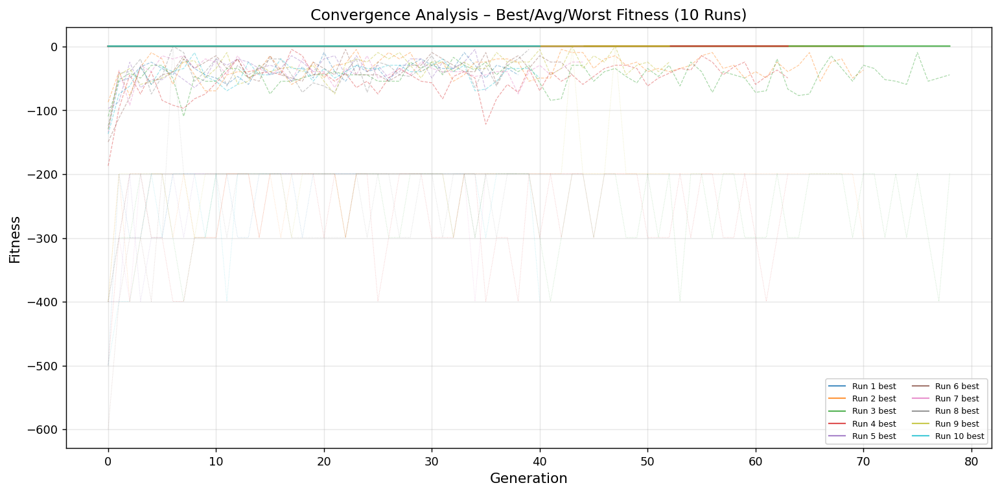
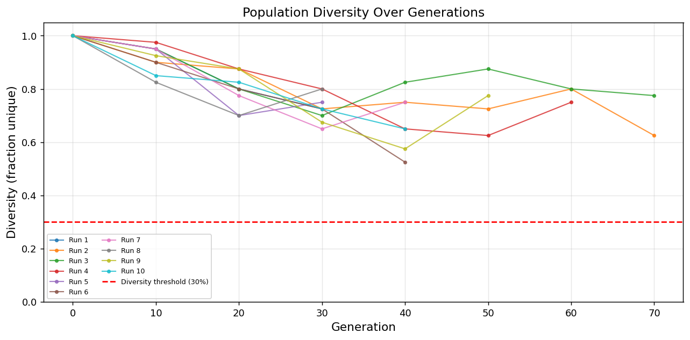
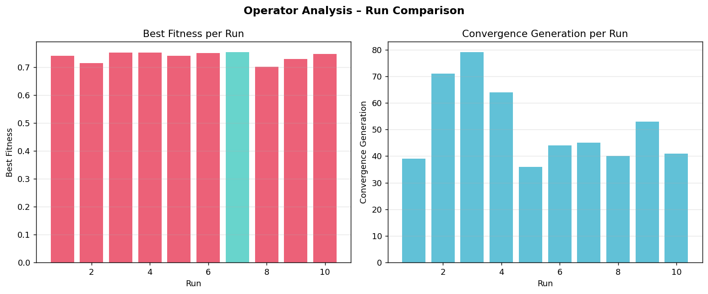

<div align="center">

# Course Scheduling Genetic Algorithm

Evolves weekly course schedules for a group of students, balancing hard constraints against time, gap, friend and workload preferences.


</div>

## Overview

Building a timetable means fitting required classes into a week without clashes, while respecting prerequisites, blocked hours and personal preferences. This project solves that for a group of students with a genetic algorithm. Each chromosome holds one schedule per student (a course and a section for every class), a fitness function rewards soft preferences and subtracts penalties for broken hard constraints, and crossover and mutation operators evolve the population, with a repair step that fixes clashes after every change. A Tkinter desktop app lets you tune the parameters and watch a run live, and a command-line runner can execute repeated seeded runs and save analysis plots.

## Demo

Plots produced by a 10-run experiment with the command-line runner:







## Key Features

- **Per-student chromosomes:** every entry stores a course, a section and the section's day and time slots, so mutations change sections rather than editing class times directly.
- **Three population seeding strategies:** random valid sections, greedy by the student's preferred hours, and greedy by the sections a friend already holds.
- **Hard constraints as penalties:** wrong credit total, time clashes, unmet prerequisites, too many meetings in a day and blocked slots (for example a part-time job) all reduce fitness.
- **Weighted soft goals:** preferred time slots, fewer gaps between classes, shared sections with friends, balanced workload (limits days with three or more hard courses) and a free lunch hour.
- **Three crossover and four mutation operators:** single-point, uniform and course-based crossover, plus section change, course swap, time-slot shift and friend alignment mutation, each followed by schedule repair.
- **Population control:** a tournament and roulette selection mix, elitism, a diversity check every 10 generations that raises mutation rates and injects random individuals when diversity is low.
- **Three stopping rules:** maximum generations, stagnation (too little improvement over a patience window) and population convergence (most individuals within a fitness tolerance).
- **Experiment tooling:** seeded multi-run experiments with summary statistics, a printed weekly timetable and friend-overlap report, saved plots, and a four-tab Tkinter app (Run GA, Schedule, Charts, Fitness) with a live fitness chart.

## Tech Stack

| Area | Technology |
| --- | --- |
| Language | Python 3 |
| Algorithm | Genetic algorithm with tournament and roulette selection, elitism, crossover, mutation and repair |
| Desktop app | Tkinter (Python standard library) |
| Plots | Matplotlib |
| Configuration | PyYAML, with built-in default settings as fallback |
| Data | JSON course catalog and student requirements |

## Project Structure

```text
main.py            # Command-line runner: single or multi-run GA, stopping rules, plots, timetable output
gui.py             # Tkinter desktop app (Run GA, Schedule, Charts, Fitness tabs)
chromosome.py      # Chromosome representation and population seeding strategies
fitness.py         # Soft-goal scoring and hard-constraint penalties
operators.py       # Crossover, mutation, adaptive rates and schedule repair
selection.py       # Tournament and roulette selection, elitism, diversity injection
utils.py           # Data loading, constraint checks, diversity metric, default settings
make_data.py       # Script that writes the sample course catalog and student requirement files
config.yaml        # GA settings file (see Limitations and Roadmap)
data/              # Sample course catalog and student requirements (JSON)
plots/             # Convergence, diversity and operator analysis plots
requirements.txt   # matplotlib and pyyaml
```

## Getting Started

### Prerequisites

- Python 3 with Tkinter. Tkinter ships with the standard python.org installers for Windows and macOS; on Debian or Ubuntu install `python3-tk`.
- No API keys are needed and the project reads no environment variables.

### Installation

```bash
git clone https://github.com/shahramshafiq/course-scheduling-genetic-algorithm.git
cd course-scheduling-genetic-algorithm
pip install -r requirements.txt
```

### Run

Run from the repository root, because the app loads `data/course_catalog.json` and `data/student_requirements.json` by relative path:

```bash
python gui.py
```

## Usage

In the desktop app, set the parameters on the Run GA tab (population size, maximum generations, number of runs, random seed, crossover probability, tournament size and the four mutation rates), then press START GA. The live chart and log update while the runs execute; when they finish, the Schedule, Charts and Fitness tabs show the best timetable found, run comparisons and the fitness breakdown per student.

To regenerate the sample data, run `python make_data.py`. It writes `course_catalog.json` and `student_requirements.json` into the current directory; move them into `data/` to use them.

The command-line runner in `main.py` accepts `--runs`, `--seed`, `--single`, `--gui`, `--courses`, `--students` and `--config`; see Limitations and Roadmap for its current setup requirements.

## Limitations and Roadmap

- The command-line runner expects a nested settings layout (population, selection, crossover, mutation, fitness, diversity, termination) like the defaults in `utils.py`, while the bundled `config.yaml` uses a different flat layout. Its default data paths also point at the repository root instead of `data/`. The desktop app uses the built-in defaults and is not affected. Aligning `config.yaml` and the default paths is the next fix.
- The bundled data is a small synthetic set: 11 courses with 3 sections each and 5 students with 3 friend pairs.
- Section capacity, instructor names and the global constraints block in the data files are loaded but not used by the fitness function.
- There are no automated tests yet; the fitness functions and the repair step are the first candidates.

## Author

**Shahram Shafiq** - [GitHub](https://github.com/shahramshafiq) | [LinkedIn](https://www.linkedin.com/in/shahramshafiq/)
